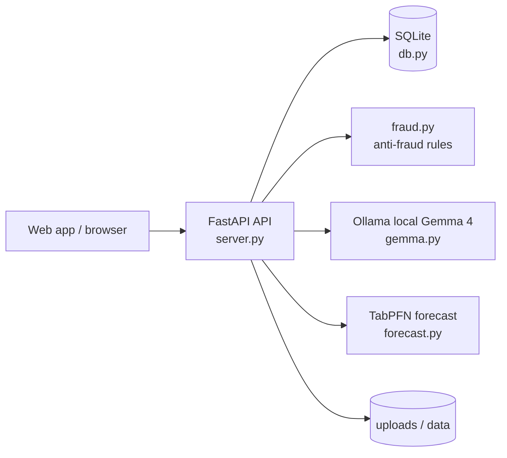

# VadeX

VadeX is a local-first invoice-finance risk platform for Turkish SMEs. It helps a KOBİ upload an invoice, validate the seller/buyer metadata, run deterministic fraud checks, and compare financing offers without sending invoice data to a cloud AI provider.

The fake-invoice problem is concrete: an outside acquaintance called the author’s father and asked, “Do you have an invoice? I need 200k.” He was not asking for a real commercial sale; he wanted a 200,000 TL invoice with no goods or service behind it, and somebody had offered a commission for it. A fake invoice (“naylon fatura”) is tax fraud: the buyer books it as an expense and deducts its VAT, while the issuer is on paper liable and can still be prosecuted. The numbers are stark: 200,000 TL + 20% VAT = 240,000 TL total. The buyer may avoid roughly 50,000 TL of corporate tax and 40,000 TL of VAT, around 90,000 TL in total, while the issuer gets a small commission and can still face 3–8 years under Turkish Tax Procedure Law art. 359. VadeX addresses the legal side of that problem by making invoice financing safer and more trustworthy before cash moves.

## Why this project exists

Small businesses often wait 60–120 days to be paid. VadeX lets a seller upload a real invoice, extract the fields, flag suspicious patterns, and assess financing viability. The final decision stays human-led, but the system makes the first review fast, local, and explainable.

## Architecture



- Browser: the UI and local app flow built around the repo’s web assets and the FastAPI backend in [server.py](https://github.com/omresenn-netizen/hf26-elazig/blob/main/server.py)
- SQLite: runtime state, offers, and audit records in [db.py](https://github.com/omresenn-netizen/hf26-elazig/blob/main/db.py)
- Fraud rules: deterministic anti-fraud checks in [fraud.py](https://github.com/omresenn-netizen/hf26-elazig/blob/main/fraud.py)
- Gemma: OCR and risk explanations through [gemma.py](https://github.com/omresenn-netizen/hf26-elazig/blob/main/gemma.py) and the local Ollama endpoint
- TabPFN: payment-delay forecast in [forecast.py](https://github.com/omresenn-netizen/hf26-elazig/blob/main/forecast.py)

## Features by role

- KOBİ: upload real or demo invoice images/PDFs, review extracted fields, inspect risk flags, compare offers, and accept a mock transfer.
- Finansör: review the invoice market, inspect the risk report, see the suggested discount rate, submit offers, and examine delay forecasts.
- Denetim: inspect the seller/buyer graph, review suspicious clusters, and read a model explanation of the network risk.

## How Gemma is used

The local Gemma 4 workflow is concentrated in [gemma.py](https://github.com/omresenn-netizen/hf26-elazig/blob/main/gemma.py) and logged to [logs/gemma.jsonl](https://github.com/omresenn-netizen/hf26-elazig/blob/main/logs/gemma.jsonl). The app also uses the same local `gemma4` model in VS Code through the Ollama provider, but the model is always treated as a bounded extractor and explainer, not as the final decision-maker.

| Task | Function | Purpose | Evidence |
| --- | --- | --- | --- |
| `extract_invoice` | `gemma.extract_invoice` | Read the invoice image and return structured JSON | [gemma.py](https://github.com/omresenn-netizen/hf26-elazig/blob/main/gemma.py), [logs/gemma.jsonl](https://github.com/omresenn-netizen/hf26-elazig/blob/main/logs/gemma.jsonl) |
| `explain_flags` | `gemma.explain_flags` | Explain rule flags in plain Turkish | [gemma.py](https://github.com/omresenn-netizen/hf26-elazig/blob/main/gemma.py) |
| `risk_report` | `gemma.risk_report` | Summarize the risk and explain the suggested discount | [gemma.py](https://github.com/omresenn-netizen/hf26-elazig/blob/main/gemma.py) |
| `compare_offers` | `gemma.compare_offers` | Rank financing offers and explain the recommendation | [gemma.py](https://github.com/omresenn-netizen/hf26-elazig/blob/main/gemma.py) |
| `invoice_insight` | `gemma.invoice_insight` | Summarize the invoice, flags, and buyer profile | [gemma.py](https://github.com/omresenn-netizen/hf26-elazig/blob/main/gemma.py) |
| `payment_comment` | `gemma.payment_comment` | Comment on payment history and due-date patterns | [gemma.py](https://github.com/omresenn-netizen/hf26-elazig/blob/main/gemma.py) |
| `offers_insight` | `gemma.offers_insight` | Compare the offers shown to the KOBİ | [gemma.py](https://github.com/omresenn-netizen/hf26-elazig/blob/main/gemma.py) |
| `ai_digest` | `gemma.ai_digest` | Create short action-oriented summaries for each role | [gemma.py](https://github.com/omresenn-netizen/hf26-elazig/blob/main/gemma.py) |
| `suspicious_network_report` | `gemma.suspicious_network_report` | Explain suspicious company or broker network patterns | [gemma.py](https://github.com/omresenn-netizen/hf26-elazig/blob/main/gemma.py) |

Measured from the current log file, the task mix is:

- `extract_invoice`: 12 calls, mean 7.06s
- `explain_flags`: 41 calls, mean 3.11s
- `risk_report`: 14 calls, mean 6.00s
- `compare_offers`: 5 calls, mean 2.87s
- `invoice_insight`: 4 calls, mean 9.58s
- `payment_comment`: 3 calls, mean 10.96s
- `offers_insight`: 2 calls, mean 4.22s
- `ai_digest`: 7 calls, mean 5.74s
- `suspicious_network_report`: 2 calls, mean 7.45s

## TabPFN payment-delay forecast

TabPFN is implemented in [forecast.py](https://github.com/omresenn-netizen/hf26-elazig/blob/main/forecast.py) and evaluated in [docs/FORECAST.md](https://github.com/omresenn-netizen/hf26-elazig/blob/main/docs/FORECAST.md). It builds chronological features from payment history and predicts the expected delay in days and the chance of a payment being more than five days late.

- Holdout split: due dates before 2026-07-03 vs. 2026-07-03 onward
- Training / test rows: 160 / 41
- MAE: 4.36 days
- Accuracy: 78.05%

A live seeded example is a Doğu Yapı invoice roughly 23 days late with about a 56% probability; the risk report feeds that forecast into Gemma so a human reviewer reads a Turkish summary instead of raw numbers.

## Fraud rules

The anti-fraud system is in [fraud.py](https://github.com/omresenn-netizen/hf26-elazig/blob/main/fraud.py). It does not auto-reject; it produces a flag list for review.

| Rule | Implementation | Notes |
| --- | --- | --- |
| Duplicate invoice | `_fingerprint` + `analyze_invoice` | SHA-256 fingerprint on seller VKN + invoice no + amount + issue date |
| Missing delivery note | `_is_service`, `has_goods`, `missing_delivery_note` | Goods invoices must have an `irsaliye_no` |
| Sector mismatch | `_item_category`, `SECTOR_TERMS` | Textile seller selling drinks is a red flag |
| Capacity outlier | `_seller_month_total` | Monthly volume far above employee count |
| Vague item | `VAGUE_TERMS` | Descriptions like “danışmanlık hizmeti” are weak |
| Buyer not approved | `buyer_not_approved` | Buyer approval must be explicit |
| Network cycle / shell company | `_network_cycle`, `_shared_young_company` | Seller→buyer loop and shell-company detection |

## OCR reconciliation and buyer VKN safety

The project includes a hard safety check for OCR slips. In [server.py](https://github.com/omresenn-netizen/hf26-elazig/blob/main/server.py), `_reconcile_parties` validates the VKN length, checks the registry, matches the exact company name, and then surfaces a user-visible “VKN corrected, please check” notice. The exact bug it fixes is an OCR slip where Gemma read buyer VKN `9100000044` as `910000044` and dropped a zero. The safety check is in commit [ec6989c](https://github.com/omresenn-netizen/hf26-elazig/commit/ec6989c).

## Local run

Requirements: Python 3.13, Ollama, and the local `gemma4` model.

```powershell
ollama pull gemma4
powershell -ExecutionPolicy Bypass -File scripts\check_setup.ps1
powershell -ExecutionPolicy Bypass -File scripts\run.ps1
```

The launcher installs dependencies, validates the local environment, and opens the app. The app calls the local Ollama API for Gemma and stores runtime data in the ignored local SQLite database.

### Seed demo state

```powershell
.\.venv\Scripts\python.exe scripts\seed_demo.py
```

Demo accounts:

- KOBİ: company VKN such as `9200000202` or `9200000505`
- Finansör: `anadolu_faktoring`
- Denetim: `denetim`
- Broker / suspicious invoice actor: `9300000904`

All passwords are `demo1234`.

### Sample files

- Clean invoice: `samples/01_gercek_icecek.png`
- Suspicious invoice: `samples/04_naylon_danismanlik.png`

## Tests and CI

The repo runs automated checks in [GitHub Actions CI](https://github.com/omresenn-netizen/hf26-elazig/actions/workflows/ci.yml) and publishes the badge here:


The CI job runs `pytest -q` and `bandit -r . -x ./.venv,./tests -ll -s B608` as defined in [.github/workflows/ci.yml](https://github.com/omresenn-netizen/hf26-elazig/blob/main/.github/workflows/ci.yml).

## Built by a GitHub Copilot agent team

The repo preserves the agent sessions in [sessions](https://github.com/omresenn-netizen/hf26-elazig/tree/main/sessions), and each agent delivered its work as a reviewed commit merged into `main`.

| Agent | What it built | Merge commit | Session |
| --- | --- | --- | --- |
| architect | repo-wide architecture and role split | [07b3058](https://github.com/omresenn-netizen/hf26-elazig/commit/07b3058) | [sessions/01-architect.md](https://github.com/omresenn-netizen/hf26-elazig/blob/main/sessions/01-architect.md) |
| kobi-builder | KOBİ upload, invoice review, and financing flow | [53fc203](https://github.com/omresenn-netizen/hf26-elazig/commit/53fc203) | [sessions/02-kobi-builder.md](https://github.com/omresenn-netizen/hf26-elazig/blob/main/sessions/02-kobi-builder.md) |
| market-builder | financier marketplace and audit workflows | [f227073](https://github.com/omresenn-netizen/hf26-elazig/commit/f227073) | [sessions/02-market-builder.md](https://github.com/omresenn-netizen/hf26-elazig/blob/main/sessions/02-market-builder.md) |
| api-builder | FastAPI contract and backend behavior | [6d9c33c](https://github.com/omresenn-netizen/hf26-elazig/commit/6d9c33c) | [sessions/02-api-builder.md](https://github.com/omresenn-netizen/hf26-elazig/blob/main/sessions/02-api-builder.md) |
| db-architect | payment history and SQLite integrity | [22a115c](https://github.com/omresenn-netizen/hf26-elazig/commit/22a115c) | [sessions/02-db-architect.md](https://github.com/omresenn-netizen/hf26-elazig/blob/main/sessions/02-db-architect.md) |
| ai-insights | AI explanations and user digests | [93fe789](https://github.com/omresenn-netizen/hf26-elazig/commit/93fe789) | [sessions/02-ai-insights.md](https://github.com/omresenn-netizen/hf26-elazig/blob/main/sessions/02-ai-insights.md) |
| devops | deployment and CI infrastructure | [223f8ce](https://github.com/omresenn-netizen/hf26-elazig/commit/223f8ce) | [sessions/02-devops.md](https://github.com/omresenn-netizen/hf26-elazig/blob/main/sessions/02-devops.md) |
| security-auditor | auth, audit logs and upload safety | [248e991](https://github.com/omresenn-netizen/hf26-elazig/commit/248e991) | [sessions/02-security-auditor.md](https://github.com/omresenn-netizen/hf26-elazig/blob/main/sessions/02-security-auditor.md) |
| fixer | invoice-flow and financing fixes | [2518192](https://github.com/omresenn-netizen/hf26-elazig/commit/2518192) | [sessions/02-fixer.md](https://github.com/omresenn-netizen/hf26-elazig/blob/main/sessions/02-fixer.md) |
| tabpfn-engineer | payment-delay forecast work | [5aeea81](https://github.com/omresenn-netizen/hf26-elazig/commit/5aeea81) | [sessions/02-tabpfn-engineer.md](https://github.com/omresenn-netizen/hf26-elazig/blob/main/sessions/02-tabpfn-engineer.md) |
| integrator | merge, validation and final handoff | [c451fbe](https://github.com/omresenn-netizen/hf26-elazig/commit/c451fbe) | [sessions/03-integrator.md](https://github.com/omresenn-netizen/hf26-elazig/blob/main/sessions/03-integrator.md) |
| writer | documentation and demo narrative | [17ce5f3](https://github.com/omresenn-netizen/hf26-elazig/commit/17ce5f3) | [sessions/02-writer.md](https://github.com/omresenn-netizen/hf26-elazig/blob/main/sessions/02-writer.md) |

The repository currently has 57 commits, and 24 of them carry the `Co-authored-by: Copilot` trailer.

## Mocks and limitations

The project intentionally uses mock services for GİB verification, buyer credit scoring, bank transfers, and e-signature. The UI labels these as DEMO / MOCK, and the app does not auto-reject suspicious invoices. The model stays local and human review remains required.

## License

[MIT](https://github.com/omresenn-netizen/hf26-elazig/blob/main/LICENSE)
